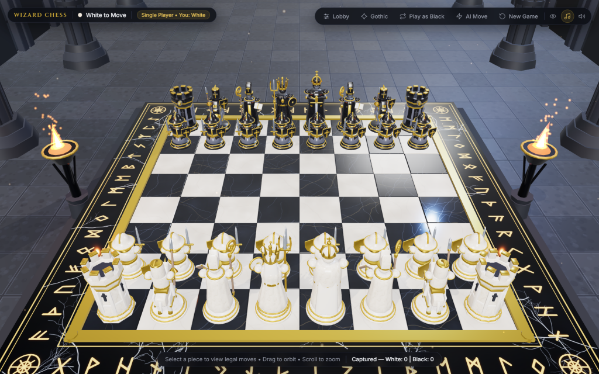
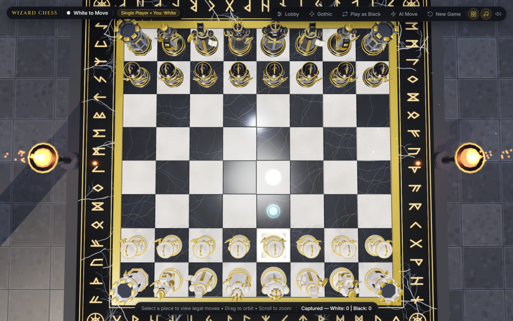
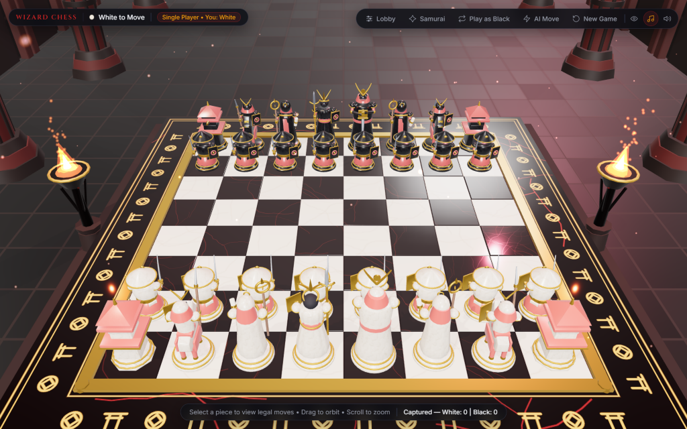
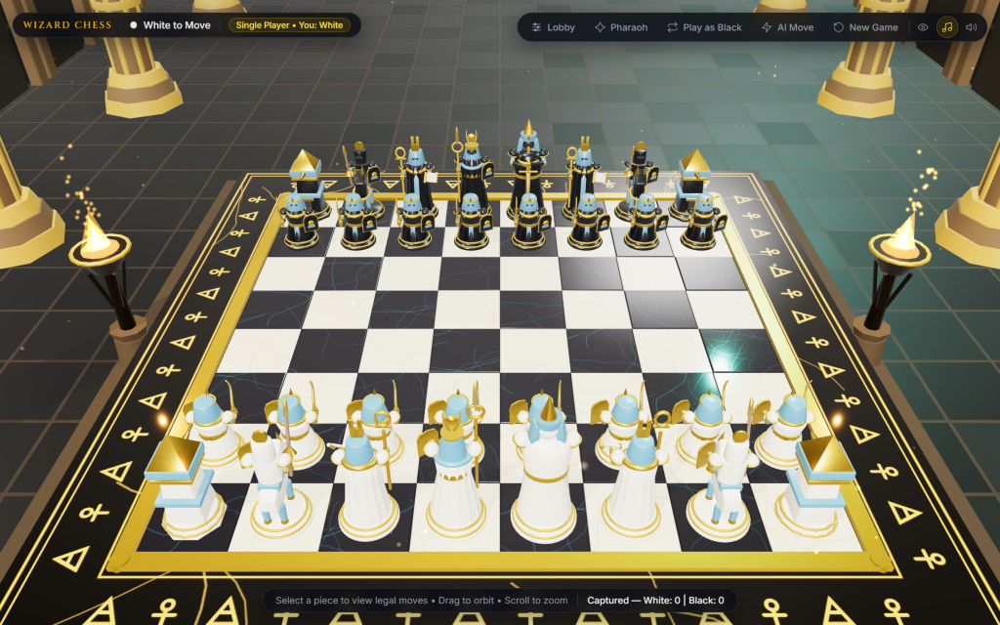
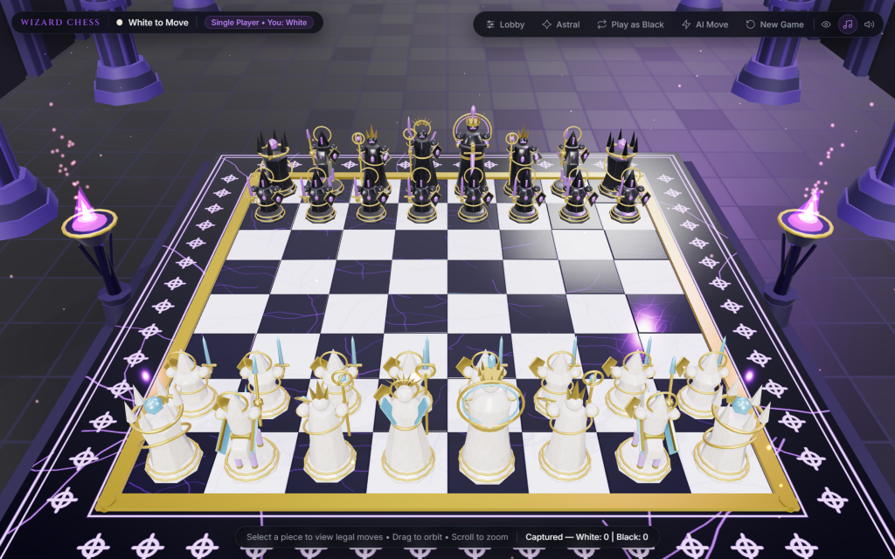
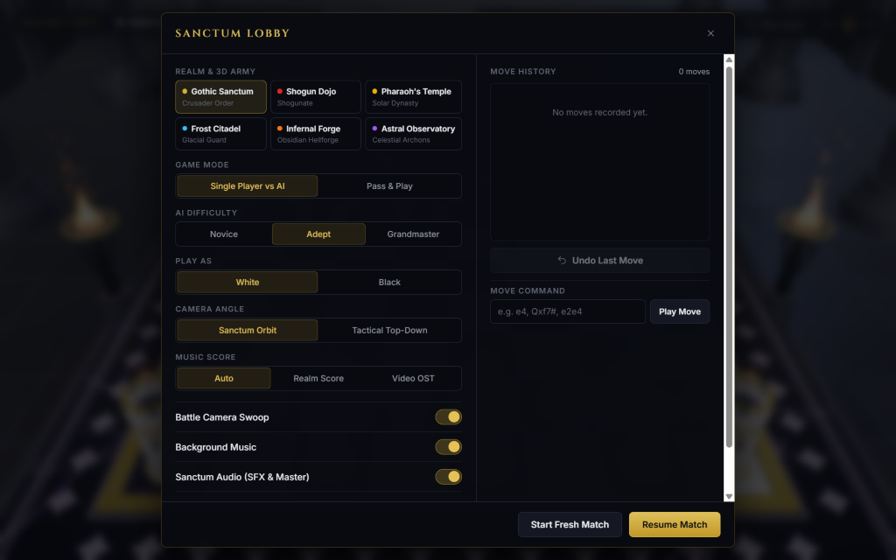
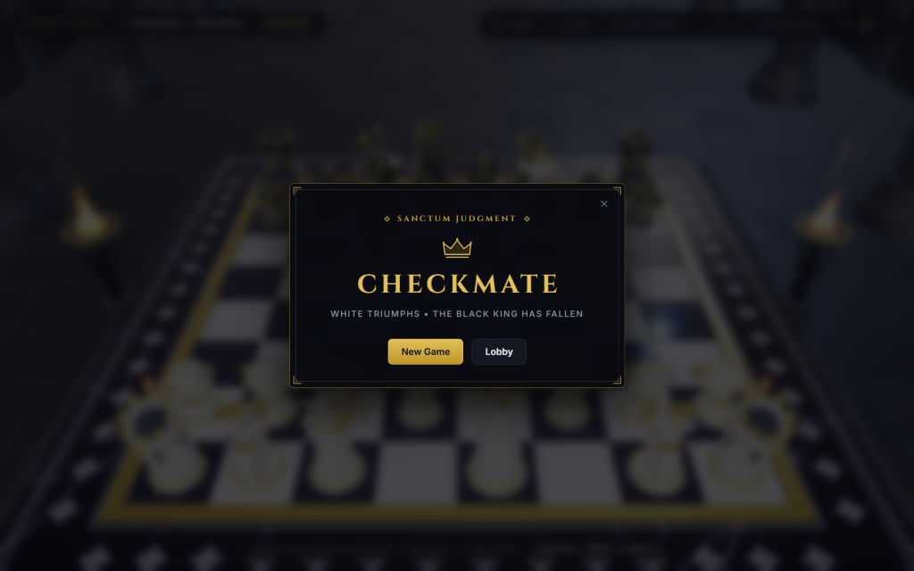

# Wizard Chess — 3D Sanctum


An interactive 3D Wizard's Chess web game featuring **6 playable 3D realms**, **8 headless-Blender sculpted `.glb` armies** (with procedural Three.js PBR fallback), **Voronoi piece-shattering combat physics**, **adaptive realm music & Web Audio SFX**, and a **non-blocking Alpha-Beta + Quiescence chess AI** — inspired by the Google Antigravity / Gemini 4 Argon showcase.

*(TR)* **6 oynanabilir 3D diyar**, **8 adet Blender `.glb` satranc ordusu** (prosedurel Three.js PBR yedek motoruyla), **Voronoi tas parcalama fizigi**, **diyarlara ozel adaptif muzik + Web Audio ses efektleri** ve **Alpha-Beta + Quiescence yapay zekasi** ile gelistirilen etkilesimli 3D Wizard's Chess oyunu.



---

## Visual Gallery / Ekran Goruntuleri

<table>
  <tr>
    <td width="50%" align="center">
      
      <br />
      <strong>Tactical Top-Down &amp; Legal Moves</strong>
      <br />
      <sub>Elder Futhark runic board, glowing cyan legal move indicators, and dual braziers</sub>
    </td>
    <td width="50%" align="center">
      
      <br />
      <strong>Shogun Dojo (Shogunate GLB Army)</strong>
      <br />
      <sub>Urushi lacquer &amp; crimson samurai pieces, shoji lanterns, and drifting sakura petals</sub>
    </td>
  </tr>
  <tr>
    <td width="50%" align="center">
      
      <br />
      <strong>Pharaoh's Temple (Solar Dynasty GLB Army)</strong>
      <br />
      <sub>Lapis lazuli &amp; solar gold pieces, hieroglyph border, and sun-lit sandstone pillars</sub>
    </td>
    <td width="50%" align="center">
      
      <br />
      <strong>Astral Observatory (Celestial Archons GLB Army)</strong>
      <br />
      <sub>Nebula stained glass, violet arcane braziers, astral sigils, and floating starlight</sub>
    </td>
  </tr>
  <tr>
    <td width="50%" align="center">
      
      <br />
      <strong>Sanctum Lobby</strong>
      <br />
      <sub>6 Realm cards, AI difficulty, Music Score selector, algebraic Move Command &amp; History</sub>
    </td>
    <td width="50%" align="center">
      
      <br />
      <strong>Sanctum Judgment — Checkmate</strong>
      <br />
      <sub>Ornate Judgment overlay after Scholar's Mate capture shatter and defeated King bow</sub>
    </td>
  </tr>
</table>

---

## 6 Playable Realms & 3D Armies / 6 Diyar ve 3D Ordular

Every realm transforms the architectural columns, stained-glass moonlight beams, flaming braziers, runic board border, atmospheric particle system, combat VFX palette, 3D army geometry, and adaptive musical score (`src/themes.ts` + `src/ui/MusicEngine.ts`):

| Realm | Army Name | GLB Model Set | Board Runes | Atmosphere &amp; Particles | Adaptive Score |
|---|---|---|---|---|---|
| **Gothic Sanctum** | Crusader Order | `wizard_white.glb` / `wizard_black.glb` | Elder Futhark | Cathedral dust motes &amp; firelight | D Dorian Choir &amp; Video OST |
| **Shogun Dojo** | Shogunate | `samurai_white.glb` / `samurai_black.glb` | Samurai Mon &amp; Kanji | Drifting sakura petals &amp; shoji glow | Hirajoshi Pentatonic Koto &amp; Taiko |
| **Pharaoh's Temple** | Solar Dynasty | `pharaoh_white.glb` / `pharaoh_black.glb` | Egyptian Hieroglyphs | Desert sunbeams &amp; gold dust | Phrygian Dominant (Hijaz) Oud &amp; Ney |
| **Frost Citadel** | Glacial Guard | `wizard_*` (Glacial PBR override) | Elder Futhark | Falling snow &amp; aurora stained glass | Nordic Crystal Harp &amp; Glacial Winds |
| **Infernal Forge** | Obsidian Hellforge | `wizard_*` (Hellforge PBR override) | Elder Futhark | Rising forge embers &amp; magma windows | Deep Phrygian War Drums &amp; Brass |
| **Astral Observatory** | Celestial Archons | `astral_white.glb` / `astral_black.glb` | Astral Sigils | Floating starlight &amp; nebula glass | Lydian Celesta &amp; Cosmic Shimmer |

---

## Core Features / Temel Ozellikler

- **Blender GLB Armies + Procedural PBR Fallback (`PieceFactory.ts`)**: Loads 8 articulated `.glb` army packs (`public/models/*.glb`) generated via headless Blender 5.3 scripts (`Piece_<type>` / `Pivot_Body` / `Pivot_Head` / `Pivot_WeaponArm` / `Pivot_ShieldArm`), seamlessly falling back to sculpted Three.js `LatheGeometry` / `ExtrudeGeometry` / `TubeGeometry` rigs when offline or in pure-code environments.
- **Wizard's Chess Combat Choreography & Shatter Physics (`PieceAnimator.ts`, `CombatFX.ts`)**: Per-archetype attack swings, knight arched leaps, dynamic Battle Camera swoops, camera shake, 24+ Voronoi stone/obsidian/ivory/gold debris shards with floor bounce, billowing smoke clouds, and defeated King bow animations on checkmate.
- **FIDE Chess Engine & Async Alpha-Beta AI (`ChessController.ts`, `ChessAI.ts`)**: Complete `chess.js` rule enforcement (castling, en passant, promotion, check/checkmate, stalemate, threefold repetition, undo with persistent 3D piece IDs) paired with an asynchronous Alpha-Beta AI (`Novice`, `Adept`, `Grandmaster`) featuring transposition tables, MVV-LVA move ordering, tapered Piece-Square Tables, and quiescence capture search.
- **Adaptive Music & Procedural Acoustics (`MusicEngine.ts`, `SoundFX.ts`)**: Supports both the extracted reference soundtrack (`public/audio/gothic_video_ost.mp3`) and 6 procedural Web Audio realm scores + ambient environments (`fire`, `wind-chimes`, `desert`, `blizzard`, `forge`, `cosmos`) that raise tension during Check, alongside zero-asset Web Audio stone/steel/brass SFX.
- **Glassmorphic Sanctum HUD (`HudOverlay.ts`, `styles.css`)**: Crisp `Cinzel` + `Inter` obsidian UI with inline SVG vector iconography, quick top-right Realm cycle & camera toggles, Sanctum Lobby with tactical FEN presets (`Standard Position`, `Scholar's Mate in 1`), direct algebraic/coordinate Move Command (`e4`, `Qxf7#`, `e2e4`), Pawn Promotion picker, and Judgment modal.

---

## Architecture / Mimari

```text
wizard-chess/
├── docs/
│   └── screenshots/                     # Widescreen (1280x800) showcase captures
├── public/
│   ├── audio/
│   │   └── gothic_video_ost.mp3         # Reference Gothic soundtrack
│   └── models/                          # Articulated Blender 5.3 GLB army packs (White & Black)
│       ├── wizard_white.glb             # Crusader Order (White)
│       ├── wizard_black.glb             # Crusader Order (Black)
│       ├── samurai_white.glb            # Shogunate (White)
│       ├── samurai_black.glb            # Shogunate (Black)
│       ├── pharaoh_white.glb            # Solar Dynasty (White)
│       ├── pharaoh_black.glb            # Solar Dynasty (Black)
│       ├── astral_white.glb             # Celestial Archons (White)
│       └── astral_black.glb             # Celestial Archons (Black)
├── scripts/
│   └── blender/
│       ├── build_wizard_pieces.py       # Headless Blender generator for Crusader GLBs
│       └── build_theme_armies.py        # Headless Blender generator for Samurai, Pharaoh & Astral GLBs
├── index.html                           # App shell, Google Fonts (Cinzel, Inter), #canvas-root & #hud-root
├── package.json                         # Dependencies and npm scripts
├── tsconfig.json                        # Strict TypeScript (ES2022, Bundler resolution, noEmit)
├── vite.config.ts                       # Vite & Vitest configuration
└── src/
    ├── main.ts                          # Bootstrap, Raycaster input, move execution loop & window.__WIZARD_CHESS__
    ├── themes.ts                        # 6 complete 3D Realm configurations (lighting, board, particles, VFX)
    ├── types.ts                         # Shared domain types, theme IDs, and square-to-world coordinate helpers
    ├── engine/
    │   ├── ChessController.ts           # chess.js wrapper, persistent piece IDs, castling/EP/promotion & undo
    │   ├── ChessAI.ts                   # Non-blocking Alpha-Beta + Quiescence AI across 3 difficulty levels
    │   └── engine.test.ts               # Vitest unit test suite (17 tests covering rules, undo & AI)
    ├── scene/
    │   ├── CathedralScene.ts            # Multi-realm 3D Sanctum architecture, PMREM RoomEnvironment IBL & OrbitControls
    │   └── CombatFX.ts                  # Move highlights, check halo, Voronoi piece shatter & smoke particles
    ├── pieces/
    │   ├── PieceFactory.ts              # GLTFLoader army loader + procedural 2K PBR sculpted fallback rigs
    │   └── PieceAnimator.ts             # Stone glide, knight leap, per-archetype attack swings & idle sway
    └── ui/
        ├── HudOverlay.ts                # Sanctum HUD, 6-Realm Lobby, Promotion picker & Judgment modal
        ├── MusicEngine.ts               # Dual-mode Video OST & 6 procedural Web Audio realm scores
        ├── SoundFX.ts                   # Procedural Web Audio sound effects synthesizer
        └── styles.css                   # Obsidian & accent-adaptive glassmorphic UI styles
```

---

## Quick Start & Commands / Kurulum ve Komutlar

```bash
# 1. Install dependencies / Bagimliliklari yukle
npm install

# 2. Start local Vite dev server (http://127.0.0.1:5173) / Gelistirme sunucusunu baslat
npm run dev

# 3. Type-check and build production bundle / Tip denetimi ve uretim derlemesi
npm run build

# 4. Preview production build locally / Uretim derlemesini onizle
npm run preview

# 5. Run Vitest unit test suite / Birim testlerini calistir
npm test
```

### Regenerating Blender GLB Armies (Optional)

The repository already ships pre-built `.glb` files in `public/models/`. If you have **Blender 5.x** installed and want to regenerate the 3D armies from Python (`bmesh`) sources:

```bash
blender --background --python scripts/blender/build_wizard_pieces.py
blender --background --python scripts/blender/build_theme_armies.py
```

---

## Controls / Kontroller

- **Select & Move**: Click a friendly piece (or its square) to preview cyan quiet-move discs and crimson capture rings, then click a highlighted destination — or drag and drop directly onto a valid square.
- **Camera**: Drag empty space or right-click drag to orbit, scroll wheel to zoom, or toggle between **Sanctum Orbit** (`player`) and **Tactical Top-Down** (`top-down`) via the top-right bar or Lobby.
- **Realms & Audio**: Click the Realm button in the top-right bar to cycle through all 6 3D realms live, or open **Lobby** to switch armies, AI difficulty (`Novice`, `Adept`, `Grandmaster`), side (`White`/`Black`), Music Score (`Auto`, `Realm Score`, `Video OST`), enter SAN/coordinate moves directly, load tactical presets, or undo moves.
